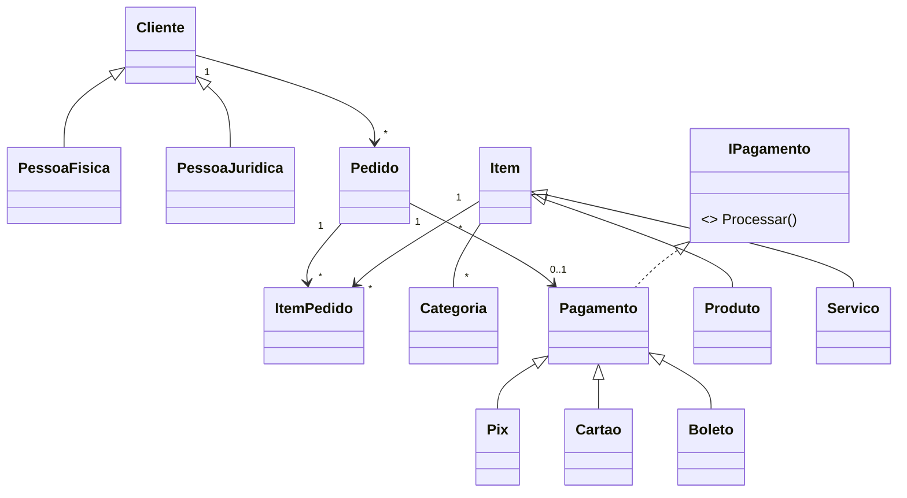
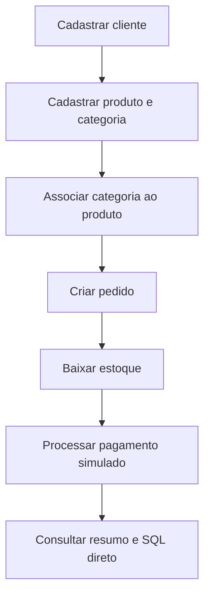

# Diagramas propostos para revisao do grupo

> Esbocos textuais Mermaid; verificar e ajustar com a modelagem efetivamente implementada e os requisitos cobrados.

## Classes e relacionamentos

## Casos de uso - descricao para desenhar em UML

Ator: Administrador da loja.

- Cadastrar/editar/excluir clientes (PF e PJ).
- Cadastrar/editar/excluir produtos e servicos.
- Gerenciar categorias e associar itens.
- Abrir pedido para cliente e incluir item/quantidade.
- Processar pagamento simulado por Pix, cartao ou boleto.
- Consultar resumo de vendas e quantidade de pedidos por SQL direto.

## Fluxo de demonstracao

